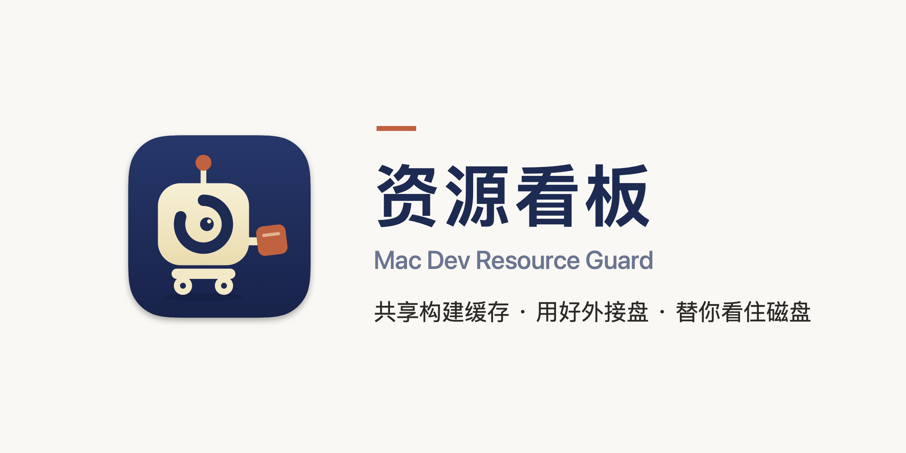
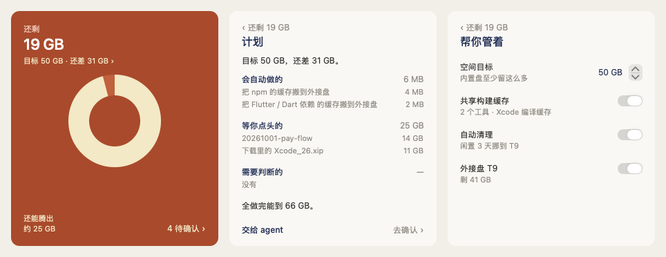

<picture>
  <source media="(prefers-color-scheme: dark)" srcset="docs/images/banner-dark.png">
  
</picture>

# Mac Dev Resource Guard · 资源看板 1.7.7

**一条命令安装，问你一次就开好共享构建缓存和外接盘；后台只清过期的编译中间缓存，任务目录和模拟器先确认再处理。** 面板平时藏在菜单栏：小机器人「小留」旁直接显示内置盘还剩多少；点击它或按 `⌃⌥⌘S` 打开。小留的眼睛就是封面上那只留着缺口的圆环——它替你把空间留出来。

适合同时跑 Xcode、模拟器、多个任务目录和多个 Agent 的 Mac 开发同学。内置 dev-storage 与 dev-memory，无需另外安装；已有同名私有工具和保护记录保留。

## 让你的 agent 来装（推荐）

把这句话发给你的 Claude Code 或 Codex：

> 帮我安装 https://github.com/ruanjianjian/mac-dev-resource-guard ，按仓库里的 SKILL.md 来。

新装时它只问你一句：默认打开共享构建缓存、内置盘至少留多少（建议约磁盘的 20%），可以吗；你说可以，装完就已经开好。升级时什么都不问。然后它按这个目标出一份计划：哪些后台会自动做、哪些要你点头、哪些需要判断，并在对话里逐项跟你确认。之后平时由后台脚本维护；出了意料之外的情况（比如某个目录一天涨了 10 GB 以上），看板会发通知，点一下就把要说的话复制好、打开你的 agent。

## 自己装

环境：macOS 13+，装好 Xcode 命令行工具（iOS 构建需要完整 Xcode）。打开「终端」，粘贴这一行：

```bash
curl -fsSL https://raw.githubusercontent.com/ruanjianjian/mac-dev-resource-guard/main/install.sh | bash
```

它会下载源码、在本机编译并装好 App 和后台任务，不用先克隆仓库；缺命令行工具时会弹出系统安装窗口，装好后再跑一次。第一次安装时最后只问一句（直接回车就是同意）：

```text
默认打开这几项：
  · 共享构建缓存：各任务共用一份工具缓存，并打开 Xcode 编译缓存（在 ~/.zshenv 加一段带标记的设置，可一键还原）；任务目录里的 Xcode 构建产物也放到外接盘
  · 外接盘「T9」：缓存和构建产物放过去；空间不够时，闲置且改动都已推送的任务也整个挪过去
（安全自动清理默认就开着：只清 7 天没用过的编译中间缓存，任务目录和模拟器不动。）
同意吗？[Y/n]
```

同意后先体检一遍（任务多时要一两分钟），看到「安装完成：都已开好」就装好了。空间目标默认是内置盘至少留磁盘的 20%，装完会写出来，之后可以在「帮你管着」里改。后台正在整理时，安装会等它做完再装。插着外接盘才会问外接盘那一项；升级时不再问，原来的选择保持不变。

升级前已暂停的维护仍保持关闭，安装输出会如实显示。

以后升级也是同一行命令。也可以克隆仓库后运行 `python3 scripts/install.py`，效果相同。

**升级不再重复要权限。** 第一次安装时，会在 `~/.local/share/dev-resource-guard/signing` 生成一张只给资源看板签名用的本机证书。它放在单独的钥匙串里，不碰登录钥匙串，也不改系统信任设置。以后每次编译都用它签名，macOS 认的是「资源看板 + 这张证书」，所以外接盘、下载文件夹这些权限点过一次「允许」就一直有效。从 1.7.5 或更早的版本升级时，系统会最后再问一次。

**自动做的事从不删任务。** 自动清理只删至少 7 天没用的四类编译中间缓存；闲置任务里的构建产物、不可用的模拟器、整份 Go/npm/pnpm 缓存都不会被自动删（不可用的模拟器列进「等你确认」）。开了外接盘、空间低于提醒线时，闲置满 3 天、改动都已提交并推送的任务整个挪到外接盘，原路径留链接；有未提交或未推送改动的留在内置盘，免得外接盘出问题时丢掉没保存的工作。上次搬迁被打断时，下一轮先补完或撤回；判断不了的保留现场。升级保留空间目标、各开关、关闭自动清理的选择、已有命令与保护记录。

### 全程后台开启共享缓存与安全清理（不使用外接盘）

安装完成后执行；不会打开面板，也不会重启正在运行的构建：

```bash
B="$HOME/Applications/资源看板.app/Contents/Resources/backend.py"
python3 "$B" checkup-firstrun
python3 "$B" checkup-off --ids external
python3 "$B" checkup-apply --ids caches,clean
```

共享缓存会在 `~/.zshenv` 写入带标记、可撤销的 `XCODE_XCCONFIG_FILE`，并为之后新开的图形 App 设置同名环境变量。有自定义全局 Xcode 设置时保留并报告冲突。现有终端/IDE 进程不会被重启，之后新开的终端和 Xcode 才会继承设置。依赖缓存沿用各工具的全局位置；没有外接盘时不迁移缓存，不把不同任务的 Pods、node_modules、Flutter build 或 SwiftPM checkout 合并共写。

验证开关与计划：

```bash
cat "$HOME/.config/dev-resource-guard/auto-cleanup.json"
launchctl getenv XCODE_XCCONFIG_FILE
"$HOME/.local/bin/resource-guard-service" target
"$HOME/.local/bin/resource-guard-service" plan --json
```

开关应为 `caches_enabled=true`、`xcode_compile_cache=true`、`auto_enabled=true`、`auto_scope=managed-caches`，且 `external_root=null`。开关开启不等于已经命中编译缓存或清出空间，请看构建日志里的 `CompilationCacheMetrics` 和实际维护记录；Xcode 缓存支持依赖工具链，已实测 Xcode 27.0。

关闭安全自动清理可在面板设置中操作，或执行 `python3 "$B" checkup-off --ids clean`；关闭共享缓存用 `checkup-off --ids caches`。关闭外接盘不会删除或迁回过去已经迁移的内容。

## 装好之后：一张封面，点一下

装好后面板不会弹出。几十秒后会收到一条「体检完成」通知。点通知或菜单栏图标（或按 `⌃⌥⌘S`），图标下方弹出一张封面：

- 左上角是内置盘还剩多少，中间一个圆环是已用的比例；空间低于提醒线时，整张从深蓝变成暖色，左下角写还能腾出多少。
- 左下角是正在帮你管的事（缓存共享、自动清理、外接盘就绪），右下角是有几项等你确认；外接盘没插时，那一行变色并写「插上就恢复」。
- 点圆环看「空间去哪了」（任务目录、模拟器、Xcode 缓存、各工具缓存、设备支持文件、归档、下载里的安装包、废纸篓、Docker，每类一根细条）；点右下角进「等你确认」勾选；点左下角进「帮你管着」。
- 封面上还有一行「目标 50 GB · 还差 N GB」，点开是计划页：会自动做的、等你点头的、需要判断的，各能腾出多少，全做完能到多少；「交给 agent」会把要说的话复制好并打开你的 agent。


- 「帮你管着」只有四行：空间目标，共享构建缓存、自动清理、外接盘三个开关，底下一行是最近一次自动腾出了多少：


| 建议 | 打开后会做什么 |
|---|---|
| 共享构建缓存 | 找出你用过的开发工具（Xcode、CocoaPods、Flutter、npm、yarn、Go、Gradle、Cargo、Homebrew、pip），缓存统一管理；插着外接盘时搬到外接盘，原位置留链接，工具照常用；任务目录里各自的 Xcode 构建产物（名字带 DerivedData 的文件夹）不在构建时也挪到外接盘，原路径留链接，之后的构建直接写到外接盘。同时全局打开 Xcode 编译缓存：同一个任务里切分支、清空重编时直接用上次的编译结果。关掉即还原：链接去掉，各工具从空开始重建缓存。 |
| 自动清理 | 每 12 小时检查固定构建槽与默认 DerivedData，只清至少 7 天未用的四类编译中间缓存。任务目录、模拟器、Products、报告及整份工具缓存保留；其他删除只进入待确认列表。 |
| 使用外接盘 | 自动挑一块空间最大、可写、不是时间机器备份盘的 APFS 外接盘，在上面建 `dev-resource-guard/` 放工具缓存和任务的构建产物；空间不够时，闲置且改动都已推送的任务也整个挪过去。开启时 macOS 会问一次能否访问可移除宗卷，请点允许。 |

任务目录不用手写：工具从 git 的工作区记录（含 Claude、Codex 建的）里找出「放任务的文件夹」，开启时一并写进设置。以前手写的设置保留。

**外接盘被拔掉时**：放在上面的缓存和任务暂时不能用，用到它们的构建会报错，工具不会在内置盘另建一份。看板会立刻发通知，封面上也会标出来；插回就恢复。

所有功能都在这张封面里；右键菜单只有「打开资源看板」和「退出」。为什么这样设计、配色、Logo「小留」、组件、动效和文案规范，见 [产品设计](docs/design.md)。

**后台在做事时会动一下，做完就停**：菜单栏的数字后面多一个轻轻闪的点，空间变多时数字慢慢涨上去；封面圆环上有一道光绕着走，圆环下写「正在整理 · 已腾出 X GB」，往外接盘挪东西时是一串点从「内置盘」流向「T9」；在「等你确认」里删除，删掉的一行行打勾、收起。系统打开了「减少动态效果」时都不动，直接显示结果。

**不承诺**：多个任务共用 Xcode 编译结果（实测换一个任务目录几乎用不上缓存）；pnpm 包仓库和 uv 缓存不搬（要和项目在同一块盘上才能共享文件）；不删 Docker、OrbStack 的镜像；不改 macOS 隐私或安全设置。

## 安装后会自动做什么

| 能力 | 实际范围 |
|---|---|
| 磁盘维护 | 安装后一次，此后每 12 小时检查固定构建槽与默认 Xcode DerivedData；仅清理符合保留期和安全检查的四类中间缓存，两类缓存都至少七天。DerivedData 换成指向外接盘的链接时按真实目录清理。 |
| 内存维护 | 每分钟检查。警告级压力持续 2 分钟就提醒（很紧立刻提醒），监控偶尔超时也不会推迟；通知由资源看板发出，没送达会重试；仍紧张时每 30 分钟再提醒。菜单栏数字旁一直写着「内存紧张」，封面顶上一条，点开内存页：自动处理了什么、哪些可以一键关、哪些正在用不能动。有归属与闲置证明才收尾托管后台；没被开发工具连着满两小时的模拟器，内存紧张时自动关（只丢当前画面，数据都在）。不是定时强制释放内存。 |
| 占用保护 | 删除前复核进程、打开文件、槽锁、pin、lease、最近使用和路径身份；在用、受保护、状态不明的内容保留。 |
| 原有安装 | 保留已有命令、合法缓存根和保护状态，复用可验证的旧守护；未知自定义调度会报告未完成，不启动第二套。 |

四类中间目录为 `Intermediates.noindex`、`Index.noindex`、`ModuleCache.noindex`、`SDKStatCaches.noindex`。保留源码、Products、任务目录、测试证据、模拟器数据和登录态；不强杀用户应用、不删除 swap。模拟器与 MCP 缺少兼容占用或排空协议时保留。

Go 编译缓存、模拟器、Claude 会话和任务目录可查看占用，但不自动删除。没有安全候选时可清理量就是 0；目录计量不等于 APFS 全盘净释放空间，不承诺固定回收容量。磁盘空间目标只提醒，不阻止构建。

## 安全自动清理（1.6.1）

`~/.config/dev-resource-guard/auto-cleanup.json` 与原有 `config.json` 分开；旧命令照常读原配置。安全范围由代码限制，不依赖某台机器手动配置。

| 范围 | 行为 |
|---|---|
| 自动维护 | 每 12 小时只回收至少 7 天未用的四类编译中间目录，执行前复核进程、打开文件、锁、pin、lease、最近读写及路径身份。信息不完整时保留。 |
| 待确认 | 旧模拟器、已推送的闲置任务、安装包、设备支持文件、归档等只列计划；明确选中确认后再次核对。 |
| 保留 | 正在使用、被保护、状态未知的内容；源码、Products、测试证据和登录态。不因空间紧张扩大删除范围。 |

```json
{
  "schema": 1,
  "auto_enabled": true,
  "auto_scope": "managed-caches",
  "ask_enabled": true,
  "caches_enabled": true,
  "xcode_compile_cache": true,
  "external_root": null
}
```

定时任务每 5 分钟唤醒，缓存清理每 12 小时一轮，待确认扫描默认每 30 分钟。关闭自动档后停止周期缓存删除；重新开启后会恢复检查。配置错误会跳过并报告，不自动换回宽泛规则。

外接盘仅在单独选择后用于工具缓存。未连接或没有权限时保留原内容，**不会退回删除任务构建产物**。已有的任务外接链接保留原样。

当前契约与升级边界见 [安全自动维护规格](docs/epics/auto-cleanup/specs/safe-cache-maintenance.md)。

## 接入 Xcode 构建缓存（进阶）

1.5 的「共享构建缓存」不用改任何项目。下面的项目入口是 1.3 起的进阶用法：给一个工作树固定一份 Xcode 构建缓存并统一回收，已接入的项目照常可用。

安装 App 不会改写已有项目脚本。每个项目接入一次，之后通过生成的入口构建，才会使用固定缓存槽。用终端接入：

```bash
cd "/你的项目目录"
"$HOME/.local/bin/resource-guard-service" integrate --project "$PWD"
```

之后执行，例如：

```bash
./.dev-resource-guard/xcode-build \
  --platform ios-simulator --configuration Debug -- \
  xcodebuild -workspace ios/App.xcworkspace \
  -scheme App -configuration Debug -sdk iphonesimulator build
```

构建脚本自己调用 xcodebuild（例如 Flutter 项目先生成工程再编译）时，用整段脚本模式：入口把这份固定缓存的位置放进你指定的环境变量，脚本不用改，只要它支持用环境变量指定 DerivedData。

```bash
./.dev-resource-guard/xcode-build --platform ios-simulator --configuration Debug \
  --cache-env ELYS_SIMULATOR_DERIVED_DATA_PATH -- ./tool/run_ios_simulator.sh build
```

缓存根配在外接盘上而盘没插时，入口直接报「缓存所在的盘未连接」，不会在内置盘另建一份。

将工程路径和 scheme 换成项目实际值；平台可选 `ios-simulator`、`ios-device`、`macos`，入口配置与原构建参数保持一致，不另传 `-derivedDataPath`。原脚本和 Agent 必须实际调用这个入口才算接入。生成的 `.dev-resource-guard/` 自带忽略规则，不会出现在 `git status` 里，也不改项目的 `.gitignore`。

同一工作树、工具链、平台和配置使用同一个槽，并通过跨进程锁串行写入；不同工作树的可变构建输出保持隔离。Go、npm、pnpm、pub、Gradle 用户下载缓存沿用工具默认全局位置，不给每个任务复制一份。Flutter 自身构建继续使用每工作树输出，不强行重定向。

## 更新

**1.7.7 起会自己更新。** 后台每天查一次有没有新的正式版本：只看发布过的版本，不看 main 上的最新提交。有新版本时，等后台空闲、内存不是「很紧」时，再用和手动安装一模一样的命令装好。装的时候不弹面板，空间目标、各个开关和 macOS 权限都保留；装好后发一条通知，例如「资源看板已更新到 1.7.8」，并用一句话说明改了什么。

- 不想自动更新：在「帮你管着」里关掉「自动更新」。
- 想马上更新：运行 `~/.local/bin/resource-guard-service update`，或者告诉你的 agent「更新资源看板」。
- 1.7.6 及更早的版本还没有自动更新，需要手动更新一次，再跑一遍安装命令即可：

```bash
curl -fsSL https://raw.githubusercontent.com/ruanjianjian/mac-dev-resource-guard/main/install.sh | bash
```

安装器只更新本工具的 App 和维护引擎；正在跑的构建和维护会用原来的版本跑完。App 在你的 Mac 上编译，用本机固定签名（见上文「升级不再重复要权限」），没有 Developer ID 公证，也不改 Gatekeeper。

## 和 Mole 一起用

通用清理（系统缓存、App 残留、安装包、找大文件）推荐交给 [Mole](https://github.com/tw93/Mole)，资源看板专管开发相关的事。随附的 skill 会教你的 agent 先运行 `resource-guard-service mole-guard`，把资源看板管的地方写进 Mole 的白名单，再让 Mole 先预演、你确认后执行。为什么要这样做、和其他工具比怎样，见 [横评报告](docs/epics/one-click-setup/tool-eval.md)：不写白名单时，Mole 会把放在外接盘上的共享缓存一起清掉。

## 可直接转发的介绍

> **资源看板 1.7：给 Mac 开发同学的磁盘空间管家（开源）**
>
> 开发机的空间总被吃光，多半不是代码本身，而是每个任务各编一份的构建产物、散在各处的工具缓存，还有不用的模拟器。资源看板帮你把它们管住：
>
> - **设一个目标**：比如「内置盘至少留 50 GB」。它按你这台机器的实际情况出计划：哪些自己会做，哪些要你点头，哪些需要判断，各能腾出多少。
> - **共享构建缓存**：常用开发工具的缓存统一放一处，Xcode 编译缓存也帮你打开，不用改项目脚本。
> - **外接盘按需开启**：可迁移闲置工具缓存，原路径照常用；任务目录不自动搬迁，拔盘时提醒。
> - **只动该动的**：会丢东西的一律先问你；正在用的、有未提交改动的、一周内用过的构建产物都不碰。
> - **系统清理交给 Mole**：系统和 App 的通用清理交给 7 万星的开源工具 Mole，动手前先把你的共享缓存护住。
> - **菜单栏一张封面**：还剩多少、在帮你管什么、有什么要你拍板，一眼看完。
>
> 最省事的装法：把这句话发给你的 Claude Code 或 Codex——「帮我安装 https://github.com/ruanjianjian/mac-dev-resource-guard ，按仓库里的 SKILL.md 来。」它会装好、问你的空间目标，再按计划逐项跟你确认。也可以自己在终端粘贴一行：
>
> `curl -fsSL https://raw.githubusercontent.com/ruanjianjian/mac-dev-resource-guard/main/install.sh | bash`

## 验证与边界

1.5「装好就省心」：新增 26 项自动化测试，全量 323 项（308 通过、15 项外部条件跳过）。在隔离主目录里实测：npm、Go（只读模块缓存）、Cargo 缓存真实搬到外接盘 T9 后读写正常，还原后链接去掉、T9 上的副本删除；打开 Xcode 编译缓存后，新开的终端自动带上设置，同一工程第二次清空重编 30 次编译全部命中缓存，关闭后新终端不再带设置。[规格](docs/epics/one-click-setup/brief.md)

1.3 已在真实 Mac 完整安装，自动清理 5 项真实缓存，目录计量约 4.86 GiB；真实 Xcode 连续构建验证了同槽复用，项目查询不会计作成功构建。此结果不是每台机器的容量承诺。

1.3.1 修复：DerivedData 是链接时整轮自动清理失败；某一类失败后看板仍只显示「已加载」；项目接入后仓库多出未跟踪文件。自动化增至 253 项（238 通过、15 项外部集成条件跳过）。

自动化共 245 项：230 通过、15 项外部集成条件跳过；CI 通过。最终原生交互复验按用户要求停止，后台实测不替代原生验收，未宣称人工验收完成。[实现与验证 PR #4](https://github.com/ruanjianjian/mac-dev-resource-guard/pull/4)

- [维护与构建规格](docs/epics/resource-dashboard/specs/automatic-maintenance.md)
- [安装与兼容入口说明](references/install.md)
- [内存保护](references/memory.md)
- [缓存复用](references/cache.md)

隔离测试：`python3 scripts/verify.py`。真实独立 launchd 验证：`python3 scripts/verify_automatic.py --home <全新测试目录>`；它只清理自建测试缓存并保留 pin/Products，结束后卸载测试标签。

## 1.6.1 真实 Mac 验证（2026-10-29）

- 开启共享缓存后，同一测试项目首次清空构建 **0/31** 命中，再次清空重编 **31/31（100%）** 命中；两次构建成功，生成的程序运行成功。这是同一工作树的实测，不代表不同工作树能全部复用编译结果。
- 在真实开发机执行安全维护，删除 **2 处旧 Intermediates.noindex，目录计量 180 KiB**。随后扫描 **105 项全部保留**：近期使用、pin、打开文件占用或包含受保护产物；剩余安全候选为 0。没有把测试夹具的容量当成真实清理收益。
- 维护期间全盘可用空间净变化约 **-872 KiB**，受其他写入影响，因此不把目录计量当作 APFS 净释放空间。
- 全程后台验证，面板窗口数为 **0**；原有目标、私有命令与 pin 记录哈希保持一致。未进行前台点击或快捷键复验，也没有终止开发任务。

[完整验证记录与复现方法](docs/validation/1.6.1-safe-maintenance.md)。每台 Mac 的安全候选不同，没有候选时清理量就是 0。
