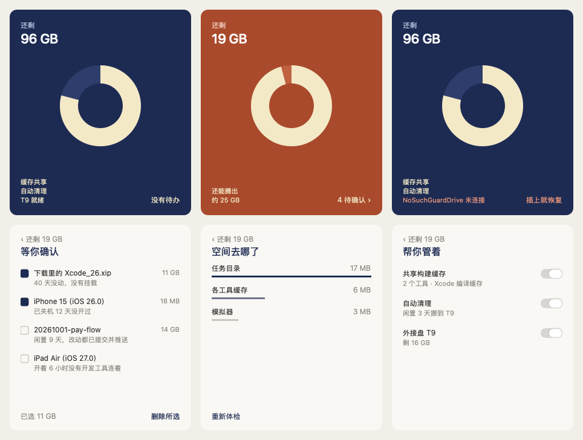

# Mac Dev Resource Guard · 资源看板 1.5

**一条命令装好，点一下就开启：帮你共享常用开发工具的构建缓存，盯住并清理占空间的东西，有外接盘就把它用起来。** 面板平时藏在菜单栏，图标旁直接显示内置盘还剩多少；点击图标或按 `⌃⌥⌘S` 打开。

适合同时跑 Xcode、模拟器、多个任务目录和多个 Agent 的 Mac 开发同学。内置 dev-storage 与 dev-memory，无需另外安装；已有同名私有工具和保护记录保留。

## 安装

环境：macOS 13+，装好 Xcode 命令行工具（iOS 构建需要完整 Xcode）。打开「终端」，粘贴这一行：

```bash
curl -fsSL https://raw.githubusercontent.com/ruanjianjian/mac-dev-resource-guard/main/install.sh | bash
```

它会下载源码、在本机编译并装好 App 和后台任务，不用先克隆仓库；缺命令行工具时会弹出系统安装窗口，装好后再跑一次。看到以下输出才算装好：

```text
安装完成：安全自动维护已启用，面板不会自己弹出。稍后会收到「体检完成」通知，点开即可一键开启共享构建缓存、自动清理和外接盘。
```

以后升级也是同一行命令。也可以克隆仓库后运行 `python3 scripts/install.py`，效果相同。

## 装好之后：一张封面，点一下

装好后面板不会弹出。几十秒后会收到一条「体检完成」通知。点通知或菜单栏图标（或按 `⌃⌥⌘S`），图标下方弹出一张封面：

- 左上角是内置盘还剩多少，中间一个圆环是已用的比例；空间低于提醒线时，整张从深蓝变成暖色，左下角写还能腾出多少。
- 左下角是正在帮你管的事（缓存共享、自动清理、外接盘就绪），右下角是有几项等你确认；外接盘没插时，那一行变色并写「插上就恢复」。
- 点圆环看「空间去哪了」（任务目录、模拟器、Xcode 缓存、各工具缓存、设备支持文件、归档、下载里的安装包、废纸篓、Docker，每类一根细条）；点右下角进「等你确认」勾选；点左下角进「帮你管着」。
- 「帮你管着」里是三个开关，另有「全部开启」：



| 建议 | 打开后会做什么 |
|---|---|
| 共享构建缓存 | 找出你用过的开发工具（Xcode、CocoaPods、Flutter、npm、yarn、Go、Gradle、Cargo、Homebrew、pip），缓存统一管理；插着外接盘时搬到外接盘，原位置留链接，工具照常用。同时全局打开 Xcode 编译缓存：同一个任务里切分支、清空重编时直接用上次的编译结果。关掉即还原：链接去掉，各工具从空开始重建缓存。 |
| 自动清理 | 沿用 1.4 的三档：闲置满 3 天的任务目录挪到外接盘（没外接盘就删能重新生成的构建产物）；会丢东西的（旧模拟器、已推送的久未用任务、久没动的大安装包、旧设备支持文件和归档、废纸篓）先发通知，你在「待确认」勾选才做。 |
| 使用外接盘 | 自动挑一块空间最大、可写、不是时间机器备份盘的 APFS 外接盘，在上面建 `dev-resource-guard/` 放缓存和闲置任务。开启时 macOS 会问一次能否访问可移除宗卷，请点允许。 |

任务目录不用手写：工具从 git 的工作区记录（含 Claude、Codex 建的）里找出「放任务的文件夹」，开启时一并写进设置。以前手写的设置保留。

**外接盘被拔掉时**：放在上面的缓存和任务暂时不能用，用到它们的构建会报错，工具不会在内置盘另建一份。看板会立刻发通知，封面上也会标出来；插回就恢复。

实时概览、磁盘缓存、开发后台、待确认列表、自动记录、接入设置这些不常用的工具，在菜单栏图标的右键菜单「更多」里。

**不承诺**：多个任务共用 Xcode 编译结果（实测换一个任务目录几乎用不上缓存）；pnpm 包仓库和 uv 缓存不搬（要和项目在同一块盘上才能共享文件）；不删 Docker、OrbStack 的镜像；不改 macOS 隐私或安全设置。

## 安装后会自动做什么

| 能力 | 实际范围 |
|---|---|
| 磁盘维护 | 安装后一次，此后每 12 小时检查固定构建槽与默认 Xcode DerivedData；仅清理符合保留期和安全检查的四类中间缓存，默认 DerivedData 至少七天。DerivedData 换成指向外接盘的链接时按真实目录清理。 |
| 内存维护 | 每分钟检查，有归属与闲置证明才收尾支持的托管后台；不是定时强制释放内存。 |
| 占用保护 | 删除前复核进程、打开文件、槽锁、pin、lease、最近使用和路径身份；在用、受保护、状态不明的内容保留。 |
| 原有安装 | 保留已有命令、合法缓存根和保护状态，复用可验证的旧守护；未知自定义调度会报告未完成，不启动第二套。 |

四类中间目录为 `Intermediates.noindex`、`Index.noindex`、`ModuleCache.noindex`、`SDKStatCaches.noindex`。保留源码、Products、任务目录、测试证据、模拟器数据和登录态；不强杀用户应用、不删除 swap。模拟器与 MCP 缺少兼容占用或排空协议时保留。

Go 编译缓存、模拟器、Claude 会话和任务目录可查看占用，但不自动删除。没有安全候选时可清理量就是 0；目录计量不等于 APFS 全盘净释放空间，不承诺固定回收容量。磁盘空间目标只提醒，不阻止构建。

## 分档自动清理（1.4）

在「帮你管着」里打开「自动清理」「外接盘」时，下面的设置会自动写好；想微调天数或路径，仍可直接改设置文件。

安全的自动做，会丢东西的先问你，判断不了的不碰。设置在 `~/.config/dev-resource-guard/auto-cleanup.json`（与 `config.json` 分开，旧命令照常读原配置），看板「接入设置」可开关两档。

| 档 | 做什么 | 默认 |
|---|---|---|
| 自动档 | 空间低于提醒线时，把闲置满 N 天（默认 3）的任务目录整个挪到外接盘、原路径留链接；外接盘不在就删闲置任务里被 git 忽略的构建产物；再删系统标为不可用的模拟器，用 go/npm/pnpm 自带命令清缓存。回到目标线就停，每次都记在「自动记录」。 | 关闭，打开一次即授权 |
| 询问档 | 关机满 7 天的模拟器删除、开着 4 小时没开发工具连着的模拟器关机、闲置满 7 天且全部提交推送的任务目录删除、没有模拟器在用的运行时删除。先发系统通知、菜单栏亮红点，你在「待确认」勾选后才执行，执行前逐项再核对。 | 打开 |
| 永不档 | 有未提交或未推送改动、正在用、被 pin 保护、含代码仓库以外文件（如报告）的任务目录；有开发工具连着的模拟器。 | — |

```json
{
  "schema": 1,
  "auto_enabled": true,
  "task_roots": [{"path": "/Users/me/work/worktrees", "external": "/Volumes/T9/work/worktrees"}],
  "auto_idle_days": 3,
  "ask": {"simulator_unused_days": 7, "simulator_unattached_hours": 4, "task_idle_days": 7}
}
```

外接盘需要授权：macOS 不允许后台命令行任务读写外接盘，所以磁盘定时任务通过「资源看板」App 运行。第一次碰到外接盘时，系统会询问是否允许「资源看板」访问可移除宗卷，请点允许；没有授权时，自动档改为删构建产物，看板「自动记录」显示「需要授权」。每次重新安装（App 签名变化）后可能需要再允许一次。

定时任务每 5 分钟唤醒：过期 Xcode 中间缓存仍 12 小时清一轮，分档清理按 `check_interval_minutes`（默认 30）检查。设置写错时本轮不清理，看板显示哪一项错了。完整契约见 [设计](docs/epics/auto-cleanup/design.md)。

## 接入 Xcode 构建缓存（进阶）

1.5 的「共享构建缓存」不用改任何项目。下面的项目入口是 1.3 起的进阶用法：给一个工作树固定一份 Xcode 构建缓存并统一回收，已接入的项目照常可用。

安装 App 不会改写已有项目脚本。每个项目接入一次，之后通过生成的入口构建，才会使用固定缓存槽。可在面板“接入设置 → 接入项目构建缓存”选择项目，也可以全程用终端：

```bash
cd "/你的项目目录"
"$HOME/.local/bin/resource-guard-service" integrate --project "$PWD"
```

之后执行，例如：

```bash
./.dev-resource-guard/xcode-build \
  --platform ios-simulator --configuration Debug -- \
  xcodebuild -workspace ios/App.xcworkspace \
  -scheme App -configuration Debug -sdk iphonesimulator build
```

构建脚本自己调用 xcodebuild（例如 Flutter 项目先生成工程再编译）时，用整段脚本模式：入口把这份固定缓存的位置放进你指定的环境变量，脚本不用改，只要它支持用环境变量指定 DerivedData。

```bash
./.dev-resource-guard/xcode-build --platform ios-simulator --configuration Debug \
  --cache-env ELYS_SIMULATOR_DERIVED_DATA_PATH -- ./tool/run_ios_simulator.sh build
```

缓存根配在外接盘上而盘没插时，入口直接报「缓存所在的盘未连接」，不会在内置盘另建一份。

将工程路径和 scheme 换成项目实际值；平台可选 `ios-simulator`、`ios-device`、`macos`，入口配置与原构建参数保持一致，不另传 `-derivedDataPath`。原脚本和 Agent 必须实际调用这个入口才算接入。生成的 `.dev-resource-guard/` 自带忽略规则，不会出现在 `git status` 里，也不改项目的 `.gitignore`。

同一工作树、工具链、平台和配置使用同一个槽，并通过跨进程锁串行写入；不同工作树的可变构建输出保持隔离。Go、npm、pnpm、pub、Gradle 用户下载缓存沿用工具默认全局位置，不给每个任务复制一份。Flutter 自身构建继续使用每工作树输出，不强行重定向。

## 更新

再跑一次安装命令即可：

```bash
curl -fsSL https://raw.githubusercontent.com/ruanjianjian/mac-dev-resource-guard/main/install.sh | bash
```

安装器只更新本工具 App 和维护引擎；构建和维护进程保留原运行时直至结束。本地按当前架构编译并 ad-hoc 签名，无 Developer ID 公证，不修改 Gatekeeper；重新安装后 macOS 可能再问一次外接盘访问权限。

## 可直接转发的介绍

> 给 Mac 开发同学推荐「资源看板 1.5」：终端里粘贴一行命令就装好，收到「体检完成」通知后点开，一键开启三件事——常用开发工具的构建缓存统一共享（Xcode 编译缓存也帮你打开）、闲置任务和过期缓存自动清理（会丢东西的先问你）、有外接盘就把缓存和闲置任务放上去。菜单栏直接显示内置盘还剩多少。正在用、有未提交改动、被保护的内容不碰。开源：https://github.com/ruanjianjian/mac-dev-resource-guard

## 验证与边界

1.5「装好就省心」：新增 26 项自动化测试，全量 323 项（308 通过、15 项外部条件跳过）。在隔离主目录里实测：npm、Go（只读模块缓存）、Cargo 缓存真实搬到外接盘 T9 后读写正常，还原后链接去掉、T9 上的副本删除；打开 Xcode 编译缓存后，新开的终端自动带上设置，同一工程第二次清空重编 30 次编译全部命中缓存，关闭后新终端不再带设置。[规格](docs/epics/one-click-setup/brief.md)

1.3 已在真实 Mac 完整安装，自动清理 5 项真实缓存，目录计量约 4.86 GiB；真实 Xcode 连续构建验证了同槽复用，项目查询不会计作成功构建。此结果不是每台机器的容量承诺。

1.3.1 修复：DerivedData 是链接时整轮自动清理失败；某一类失败后看板仍只显示「已加载」；项目接入后仓库多出未跟踪文件。自动化增至 253 项（238 通过、15 项外部集成条件跳过）。

自动化共 245 项：230 通过、15 项外部集成条件跳过；CI 通过。最终原生交互复验按用户要求停止，后台实测不替代原生验收，未宣称人工验收完成。[实现与验证 PR #4](https://github.com/ruanjianjian/mac-dev-resource-guard/pull/4)

- [维护与构建规格](docs/epics/resource-dashboard/specs/automatic-maintenance.md)
- [安装与兼容入口说明](references/install.md)
- [内存保护](references/memory.md)
- [缓存复用](references/cache.md)

隔离测试：`python3 scripts/verify.py`。真实独立 launchd 验证：`python3 scripts/verify_automatic.py --home <全新测试目录>`；它只清理自建测试缓存并保留 pin/Products，结束后卸载测试标签。
