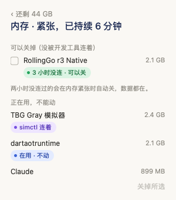
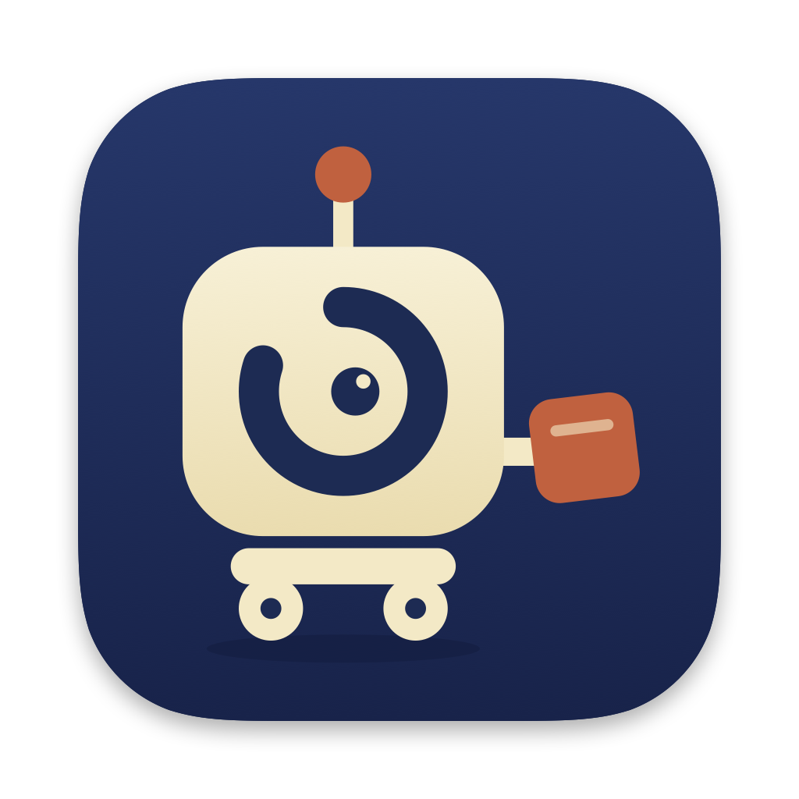
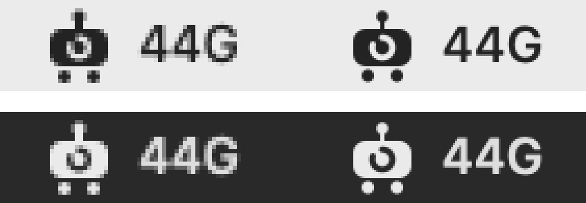
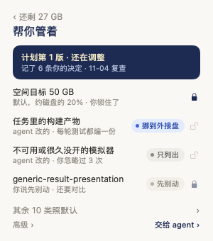

<picture>
  <source media="(prefers-color-scheme: dark)" srcset="images/banner-dark.png">
  
</picture>

# 资源看板 · 产品设计

这份文档是资源看板的设计说明书，写给改界面、写文案、做宣传，或者想在别处复用这套风格的人。行为细节以 [epics](epics/) 下的规格为准；这里只讲为什么这样设计、长什么样、该怎么用。

## 一句话

**给 Mac 上做开发的人用的磁盘空间管家，装好就省心。**

它做三件事：

1. 把常用开发构建缓存共享起来，各任务不用各编一份。
2. 看住那些会越长越大的东西，安全地腾出空间。
3. 插着外接盘时，把能放的东西放过去。

适合的人：同时开着 Xcode、模拟器、多个任务目录和多个 agent。他们常见的麻烦是：

- 每个任务各编一份构建产物，一份就有 8–10 GB；
- 模拟器悄悄吃掉几十 GB；
- 外接盘插着却没用上；
- 清理工具不敢用，怕删错东西。

## 设计原则

| 原则 | 意思 | 落在哪里 |
|---|---|---|
| **傻瓜** | 问一次就开好，之后不用管 | 新装只问一句；升级什么都不问，还会自己更新；权限点过一次「允许」，以后升级不再问 |
| **不打扰** | 不抢你的屏幕，不吵你 | 面板从不自己弹出；通知只在要你拍板或出了意外时发；后台做事时，菜单栏只轻轻闪一个点 |
| **剃刀** | 只留核心，能删就删 | 「帮你管着」只列改过的规则，其余照默认收成一行；开关收进「高级」；右键菜单只有「打开」和「退出」；不做「一键释放内存」 |
| **安全先于省空间** | 自动做的事都能恢复或重建 | 自动只清 7 天没用过的编译中间缓存，并把闲置、改动已推送的任务挪去外接盘，原地留一个链接；删除一律先问你，写清会失去什么，执行前再核一遍 |
| **说人话** | 读起来像人在跟你说话 | 大小写成「27 GB」「4.2 GB」；每一项都写理由和会失去什么；不出现技术词 |
| **分工清楚** | 规则内的事机器做，要取舍的事人来定 | 后台按规则做；需要判断的部分交给你的 agent，在对话里逐项和你确认 |

## 产品结构


菜单栏里平时只有小留和剩余空间，例如「小留 44G」。点一下（或按 `⌃⌥⌘S`），会在鼠标所在的屏幕弹出**封面**。

| 页面 | 回答什么问题 | 从哪进 |
|---|---|---|
| 封面 | 还剩多少？够不够？有没有事要我管？ | 点菜单栏图标 |
| 空间去哪了 | 空间都被谁占了？ | 点封面中间的圆环 |
| 帮你管着 | 计划到哪一步了？谁改了什么、为什么？ | 点封面左下角 |
| 高级 | 想自己开关某一项 | 「帮你管着」底部的「高级 ›」 |
| 等你确认 | 哪些东西要我点头才能删？ | 点封面右下角 |
| 计划 | 离我的目标还差多少？怎么补上？ | 点封面上「目标 50 GB · 还差 7 GB ›」这一行 |
| 内存 | 内存为什么紧？哪些能关？ | 点封面顶上的「内存紧张 ›」，或点内存通知 |

后台把事情分成三段：

- **自动做**：规则内、可恢复、能重建的事。
- **等你点头**：会丢东西的删除，比如模拟器、旧安装包、闲置任务。
- **需要判断**：工具判断不了的情况，比如一个任务里有三份构建产物。这部分交给你的 agent。

## 视觉语言

### 色板

封面只有两种底色：**深蓝表示一切正常，暖红表示已经低于提醒线**。一种颜色只表达一种意思。

| 名称 | 色值 | 用在哪 |
|---|---|---|
| 深蓝 | `#1D2B53` | 正常时的封面底色、页面标题、打开的开关、小留的底色 |
| 深蓝轨道 | `#2E3D6B` | 深蓝封面上圆环的剩余部分 |
| 雾蓝 | `#B9C2DE` | 深蓝封面上的次要文字 |
| 暖红 | `#A94A2C` | 低于提醒线时的封面底色 |
| 暖红轨道 | `#C0613F` | 暖红封面上圆环的剩余部分；小留捧的缓存块和天线灯 |
| 浅暖 | `#F2C9B8` | 暖红封面上的次要文字 |
| 奶油 | `#F3E9C6` | 圆环的已用部分、封面上的强调字、小留的机身 |
| 珊瑚 | `#F0997B` | 「外接盘没接上」 |
| 纸白 | `#FAF8F4` | 封面后面各个页面的底色 |
| 正文 | `#2B2A27` | 页面正文 |
| 次要 | `#8A877F` | 说明文字、大小、小注 |
| 分隔线 | `#E6E2DA` | 行与行之间 0.5 pt 的细线 |
| 条形图 | `#1D2B53` / `#6B7591` / `#C9C5BC` | 「空间去哪了」里由大到小的三档 |

### 状态标签

内存页每一行的状态用一枚亮色标签表示，前面带一个小圆点：

| 标签 | 底色 | 文字 | 圆点 | 例子 |
|---|---|---|---|---|
| 可以关（绿） | `#DCF4E4` | `#16703C` | `#22A35A` | 3 小时没连 · 可以关 |
| 在用（蓝） | `#E3EBFF` | `#2747A8` | `#3A63D6` | 在用 · 不动 |
| 开发工具连着（紫） | `#EEE5FF` | `#5534B8` | `#7650E0` | baguette 连着 |
| 会自动收尾（橙） | `#FFEED4` | `#9A5600` | `#E08A10` | 闲置 · 会自动收尾 |



### 字体与尺寸

- 字体用系统字体（SF 和苹方）。菜单栏里的数字用等宽数字，数字变化时不会左右跳动。
- 字号：

  | 用途 | 字号 |
  |---|---|
  | 封面大数字 | 22，中等粗细 |
  | 页面标题 | 16，中等粗细，深蓝 |
  | 正文和行标题 | 12 |
  | 说明和大小 | 11 |
  | 标签和小注 | 10.5 |

- 面板 300 × 340 pt，四周留白 18 / 16。
- 圆环直径 104、线宽 30。开关 30 × 18。
- 每页只有一种强调色，其余都是黑、灰和纸白。

## Logo「小留」



**小留**是一只原创的小机器人，它勤快，默默帮你收拾。名字取自「留」：替你把空间留出来。

- **眼睛**就是封面上那只留着缺口的圆环。缺口在十点到十二点之间，和封面圆环上「剩下的空间」在同一个位置。看到它的眼睛，就能想到「还剩多少」。
- **手里捧着一块缓存**（暖红色小方块），稍微倾斜，像正在搬。
- **头顶有天线灯，脚下有两个轮子**：它会到处跑，替你搬东西。
- 它不是瓦力，也不像任何现有角色。没有双筒眼，没有黄色方盒身体，也没有履带。

**构成**

- 画在 1024 × 1024 的画布上：中间是 824 × 824 的连续圆角方块（圆角 185.4），也就是 macOS 标准图标网格，外面留出投影的位置。
- 角色画在 160 × 160 的网格里：
  - 底色是深蓝渐变，从 `#26376A` 到 `#18234A`；
  - 机身是奶油渐变，从 `#F7F0D6` 到 `#EADCAF`；
  - 眼睛是 80% 的圆环，线宽 10，中间有瞳孔和一个高光点；
  - 缓存块和天线灯都是 `#C0613F`。

**菜单栏版**

- 18 pt 的模板图，造型是实心机身、镂空的眼环、天线和两个轮子。它对应 App 图标的单色版：奶油色机身、深蓝眼睛。
- 1 倍屏和 2 倍屏各画一份，并对齐到像素，外接的 1 倍显示器上也清楚。
- 颜色由系统决定，浅色和深色菜单栏都会自动变色。



**使用规则**

- 不要拉伸，不要换配色，不要去掉眼睛的缺口。
- 菜单栏版只用单色，不加颜色。
- 图标周围至少留出图标宽度的 1/8 作为空白。
- 最小尺寸：App 图标 16 px，菜单栏 18 pt。
- 不要和瓦力或其他现有角色放在一起，也不要画成它们。

**源文件**

- 所有图形只有一份来源：[`widget/Logo.swift`](../widget/Logo.swift)。
- App 图标在安装编译时由同一份代码生成（`ResourceDashboard --render-icon` 生成图片，再用 `iconutil` 打包）。
- README 头图和 [`images/icon.png`](images/icon.png) 用下面这条命令重新导出：

```bash
xcrun swiftc -parse-as-library widget/Logo.swift scripts/render_brand.swift -o /tmp/render_brand && /tmp/render_brand docs/images
```

## 组件

- **封面圆环**：奶油色是已用比例，轨道色是剩余空间。后台整理时，会有一道光绕着圆环走。点圆环进入「空间去哪了」。
- **「帮你管着」卡片**：封面左下角一张半透明圆角卡片，标题「帮你管着 ›」，下面勾着开着的几项，例如「✓ 缓存共享 ✓ 自动清理 ✓ T9 就绪」，每行两项，不在词中间折行。外接盘没接上时那一项用珊瑚色；空间紧张时改写「还能腾出约 25 GB」。鼠标移上去卡片变亮、指针变小手。后台在干活时卡片只留标题一行，把位置让给圆环下面的进度。
- **计划页**（「帮你管着」，视觉稿 B）：
  - 顶部一张深蓝小卡，奶油色写「计划第 N 版 · 还在调整」或「计划已定稿」，雾蓝小字写记了几条你的决定、几号复查。
  - 下面只列改过的：空间目标总在第一行，其后是你或 agent 改过、或你锁住的规则和设置，以及「先别动」的东西。
  - 每行标题 12、谁定的和为什么 10.5（灰），右边是做法标签（挪到外接盘蓝、自动清绿、先问橙、只列出和不管灰）和锁（锁住深蓝、没锁浅灰）。
  - 其余照默认的收成一行「其余 N 类照默认 ›」，点开才看。底部左「高级 ›」、右「交给 agent ›」。

  
- **设置行**（「高级」页）：标题 12，说明 11（灰色）。右侧控件（开关、`− 50 GB +`）都对齐在同一条右边线上。
- **勾选、全选、删除所选**：点删除先弹确认，写清会失去什么。删除进行中，列表变灰、不能点，底部只留一行进度，例如「正在核对并删除 3 项，好了会告诉你…」。
- **状态标签**：见上方色板。标签文字一眼读完，10 个字以内，用「 · 」分开状态和结论。
- **内存条**：内存紧张时，封面顶部出现一个奶油色胶囊，例如「内存紧张 · 模拟器 3 台占 7 GB ›」。

## 动效

动效只做一件事：**让你看见后台正在干活、干成了什么**。系统打开「减少动态效果」时，下面这些动效都不播放。

| 场景 | 动效 | 时长 |
|---|---|---|
| 后台正在做事 | 菜单栏数字后面多一个点，明暗交替 | 每 0.6 s 切换一次 |
| 空间变多 | 菜单栏和封面上的数字从旧值滚到新值 | 0.6 s |
| 已用比例变化 | 圆环收拢到新的比例；整理中，一道光绕着圆环走 | 0.8 s，缓出 |
| 挪到外接盘 | 一串点从「内置盘」流向外接盘的名字，下面写任务名和大小 | 持续到挪完 |
| 删除完成 | 删掉的行从上到下依次打勾，再向左淡出、收起 | 打勾 0.15 s，收起 0.25 s |
| 开关 | 圆点滑到另一边 | 0.15 s |

## 文案

- **用「你」**，句子短，先说结论，再说原因。
- **大小怎么写**：10 GB 以上取整，比如「27 GB」；1–10 GB 保留一位小数，比如「4.2 GB」；小于 1 GB 写成 MB，比如「18 MB」；再小就写「不到 1 MB」。
- **每个待确认项写三件事**：是什么、为什么能删、会失去什么。
- **不写技术词**：
  - 「DerivedData」写成「Xcode 构建产物」；
  - 「launchd_sim」写成「模拟器」；
  - 「TCC」写成「macOS 会问你能不能访问外接盘」。
- 不用感叹号，不写吓人的话。

| 不好 | 好 |
|---|---|
| 检测到 DerivedData 冗余副本 3 个 | 这个任务有 3 份 Xcode 构建产物，一周以上没用的有 2 份 |
| 正在用的程序，不动 | 在用 · 不动（标签） |
| 确认已过期，未执行 | 已删除 3 项，腾出约 14 GB；1 项刚被别处用到，先留着 |

## 提醒与通知

- **菜单栏数字的颜色**：
  - 低于提醒线（就是你定的目标）时变橙色；
  - 低于低水位（目标的一半）时变红色。
  - 内存紧张时，数字旁边写「内存紧张」（橙）或「内存很紧」（红）。
- **什么时候发通知**：
  - 有新的待确认项：同一天只提醒一次；空间掉到低水位以下时，再提醒一次。
  - 内存紧张持续 2 分钟（很紧时立刻），之后每 30 分钟提醒一次；通知没送达会重试。
  - 出了意外，比如整理完仍低于目标，或某处一天涨了 10 GB 以上：点通知会在你的 agent 里打开一个新对话，要说的话已经填好，按回车发送。
  - 自动更新装好后：「资源看板已更新到 X」，正文是这次 Release 说明的第一行。同一个版本只提醒一次，这一次不再发「体检完成」。
- 点通知会直接打开对应的页面。面板不会自己弹出来。

## 安装与权限

- **一句话安装**：把仓库链接发给自己的 Claude Code 或 Codex。新装时它只问一句：默认打开共享构建缓存、内置盘至少留 X GB（约磁盘的 20%），可以吗。升级时什么都不问。
- **自己装**：在终端跑一行命令，最后只问一句，直接回车就是同意。
- **权限只问一次**：
  - 第一次安装时，在本机生成一张只给资源看板签名用的证书，以后每次编译都用它签名。
  - 所以外接盘、下载文件夹这些权限，点过一次「允许」以后升级不再问。
  - 每台 Mac 都生成自己的一张，谁装都一样。
- **自己更新**：每天查一次正式版本，空闲时用同一条安装命令装好，装好发通知；「帮你管着」里可以关掉。只认打了 tag 的 Release，合进 main 不等于发布。
- **装完不打扰**：安装结束不弹面板，只在菜单栏出现小留。

## 素材索引

| 文件 | 是什么 |
|---|---|
| [`images/banner.png`](images/banner.png)、[`images/banner-dark.png`](images/banner-dark.png) | README 头图，浅色和深色各一张，2560 × 1280，也能当 GitHub 分享卡片 |
| [`images/icon.png`](images/icon.png) | App 图标，1024 × 1024 |
| [`images/menubar.png`](images/menubar.png) | 真实菜单栏按钮的渲染：浅色、深色，1 倍和 2 倍 |
| [`images/cover.png`](images/cover.png) | 封面三种状态，以及「等你确认」「空间去哪了」「帮你管着」三个页面 |
| [`images/memory-tags.png`](images/memory-tags.png) | 内存页和状态标签 |
| [`images/plan.png`](images/plan.png) | 计划页 |
| [`../widget/Logo.swift`](../widget/Logo.swift) | 小留的唯一图形来源 |
| [`../widget/Cover.swift`](../widget/Cover.swift) | 色板（`Ink`）、封面和各个页面、状态标签 |
| [`../widget/Motion.swift`](../widget/Motion.swift) | 动效 |

## 设计决定记录

| 日期 | 决定 | 依据 |
|---|---|---|
| 2026-10-28 | 首页改成菜单栏里的一张封面：深蓝或暖红底，中间一个奶油色圆环 | 三轮视觉稿：太花哨，改得更简单，再改得更雅致（[menubar-cover](epics/one-click-setup/specs/menubar-cover.md) CH-01） |
| 2026-10-29 | 剃刀：去掉「更多」大窗口，「帮你管着」只留四行，加四个动效 | RAW-36，视觉稿确认（CH-05） |
| 2026-10-29 | 内存提醒：菜单栏写「内存紧张」，封面顶上加一条，新增内存页 | RAW-39、RAW-40，选 A（CH-06） |
| 2026-10-29 | Logo「小留」：原创小机器人，不用瓦力（瓦力是皮克斯角色，有版权） | RAW-42～44（CH-08） |
| 2026-10-29 | 内存页状态改成彩色标签，标签放在名字下面 | RAW-45、RAW-46，选 A（CH-09） |
| 2026-10-29 | 本机固定签名，权限只问一次，谁装都一样 | RAW-47～49（[one-line-install](epics/one-click-setup/specs/one-line-install.md) CH-04） |
| 2026-10-29 | 这份设计文档 | RAW-50 |
| 2026-10-29 | 自动更新：只认正式版本，空闲时装，装好发通知；「帮你管着」加第五行 | RAW-51、RAW-52（one-line-install CH-05） |
| 2026-10-29 | 封面左下角改成「帮你管着 ›」半透明卡片，一看就知道能点 | RAW-53～55，视觉稿选 B（menubar-cover CH-11） |
| 2026-10-30 | 「帮你管着」改成 agent 的计划页：状态卡 + 只列改过的 + 锁，开关收进「高级」 | 资源管理 agent RAW-10、RAW-16，视觉稿选 B（plan-page） |

原话都记在 [raw-input](epics/one-click-setup/raw-input.md) 里。
