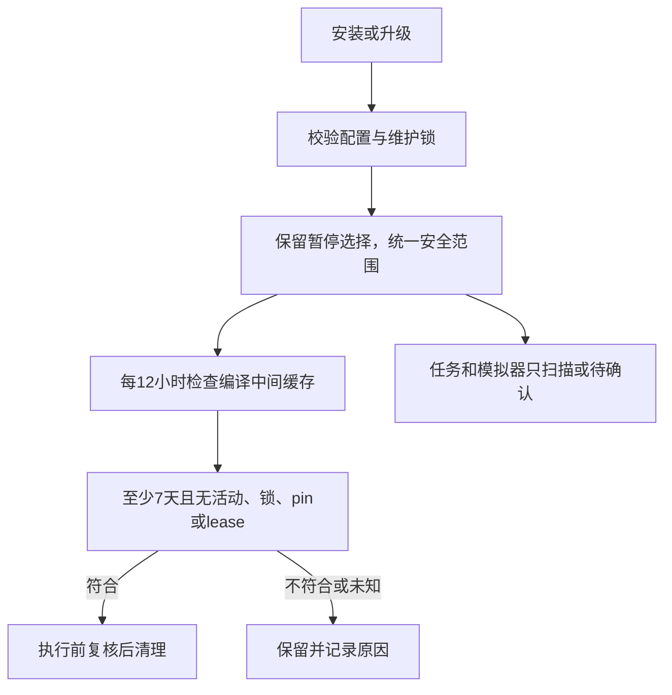

# 安全自动维护 1.6.1

## 原始输入

见 [原始输入](safe-cache-maintenance.raw-input.md)。用户要求把本机安全补丁推广到所有安装用户，保留正在运行的任务，后台验证，更新公开安装说明并提交合并。原 1.4 自动档的任务搬迁/裁剪、不可用模拟器删除及整份工具缓存清理规则由本规格替代。

## 意图与边界

自动清理仅指固定构建槽和默认 Xcode DerivedData 中至少 7 天未用的四类中间缓存：Intermediates.noindex、Index.noindex、ModuleCache.noindex、SDKStatCaches.noindex。空间目标不成为构建门禁，也不放宽保留期。任务目录、模拟器、Products、证据、登录态与整份工具缓存不进入自动删除路径。开了外接盘时，空间低于提醒线会把闲置满 3 天、改动都已提交并推送的任务整个挪过去（不删，原路径留链接）；系统标为不可用的模拟器只列进「等你确认」。

新安装默认启用该安全维护。升级兼容缺少 auto_scope、旧 standard 和本机先行 managed-caches 配置，并统一安全范围，保留暂停选择。被打断的搬迁下一轮先补完或撤回，记录看不懂的保留现场、核对前不再搬迁；新的搬迁不得覆盖旧记录。用户单独同意的外接工具缓存迁移仍可使用，外接盘缺失/拒绝访问不触发任务裁剪。

共享缓存仍需开启；不把不同工作树的可变产物共写。现有构建继续运行，新开的终端/IDE继承全局 Xcode 设置。界面默认隐藏。

## 验收标准

| ID | 级 | Given | When | Then | 落点 | 状态 | 证据 |
|---|---|---|---|---|---|---|---|
| AC-01 | [核] | 新用户、旧版 standard 或本机先行配置，空间低于目标 | 载入配置并执行自动档 | 统一安全范围：不自动删任务、构建产物、模拟器或整份工具缓存；开了外接盘时只把闲置满 3 天、改动都已提交并推送的任务整个挪过去（原路径留链接，回到目标线就停），有未提交或未推送改动的留在内置盘；系统标为不可用的模拟器列进「等你确认」 | CLI后端 | ✅ | auto: test_managed_scope（闲置已推送的整个挪走且产物不删、没开外接盘时不动、未提交/未推送的不挪、不可用模拟器只进待确认、计划里是「挪」不是「删」）；红: 1a90ee7 上这些用例失败 |
| AC-07 | [核] | 上次搬迁被打断（断电、拔盘、睡眠） | 下一轮自动档 | 先补完或撤回：原目录还在就删外接盘上不完整的副本，换链接前停住的补上链接；记录看不懂的保留现场并写明需人工核对，核对前不再搬迁 | CLI后端 | ✅ | auto: test_managed_scope.test_an_interrupted_move_is_finished_or_undone_first、test_tiers 的各阶段恢复与记录看不懂时保留 |
| AC-02 | [核] | 缓存过期或在用、被保护、含受保护产物 | 周期维护 | 两类缓存均至少保留 7 天，复用进程/文件/锁/pin/lease与身份复核；安全候选才执行 | CLI后端 | ✅ | auto: test_scheduled_cache_maintenance_preserves_seven_days_in_both_families及既有storage保护测试；真实Mac：2处/180 KiB，复扫105项保留；红: 基线无统一7天约束 |
| AC-03 | [核] | 自动清理关闭、扫描中关闭，或设置错误 | 定时维护/重新启用 | 不删除；失败写新回执，不能显示旧成功；重新启用恢复检查 | CLI后端 | ✅ | auto: test_pause_blocks_real_expired_cache_then_enable_resumes、test_disable_during_scan_prevents_delete、test_invalid_config_replaces_stale_success_receipt_without_deletion；红: 基线无auto_enabled删除门 |
| AC-04 | [核] | 已暂停/旧维护在途/旧配置错误 | 更新安装 | 保留暂停；忙时保持旧App，等待下次重试，不杀维护；错误配置在替换前拒绝 | 安装器 | ✅ | auto: test_activate_keeps_existing_pause_without_resuming_memory、test_installer_does_not_replace_app_while_maintenance_runs、test_installer_rejects_invalid_settings_before_any_subprocess；红: 基线activate移除storage-paused且安装不取维护锁 |
| AC-05 | [核] | 新版构建与后台操作入口 | 安装并开启缓存/安全清理 | 安装包自检通过，不弹面板；Xcode设置可被新进程读取，同工作树可重用缓存，外接盘关闭 | CLI、App启动 | ✅ | 真实验证与安装记录见公开验证报告；不以夹具容量替代真实结果 |
| AC-06 | [边] | 原生操作面板 | 查看新文案与计划 | 只描述安全范围，不将整份任务容量计入自动收益 | CLI、mac原生文案 | ⚠️CH-01 | auto: 计划/后端行回归和Swift自检；前台文案点击验收未做，用户要求全程后台不弹面板 |

## 流程

## 变更记录

- 2026-10-29：按用户要求将本机安全限制推广到正式安装；替代旧自动档删除范围。共享工具缓存迁移保持单独授权。
- CH-02（2026-10-29，1.7.1）：用户在另一台电脑的会话里说「别动正在跑的任务。外接盘不用」，#13 据此把「闲置任务挪到外接盘」和「中断搬迁自动收尾」也一并停掉；这偏离了项目预期（用好外接盘、装好就省心）。用户随后在本机会话里明确：「不是以13为准。而是以你为准，13的做法不一定正确。你要看它是否符合我们的预期」。改为：删除范围维持 #13；开了外接盘时恢复挪闲置且改动都已推送的任务（不删）；中断的搬迁下一轮先补完或撤回；不可用模拟器进「等你确认」（AC-01、AC-07）。
- CH-01：用户要求“全程后台做”，本轮不打开原生面板做前台点击验收；保留真实未测状态。后端输出、计划、自检和窗口隐藏已验证，不冒称前台验收通过。

## 实现前 AI 总结

AI 转述，非需求真值，仅供对账：默认和升级都应收窄自动删除范围，公开真实清理与缓存命中结果；不得停止活跃任务，不弹面板，不为达空间目标放宽规则。
